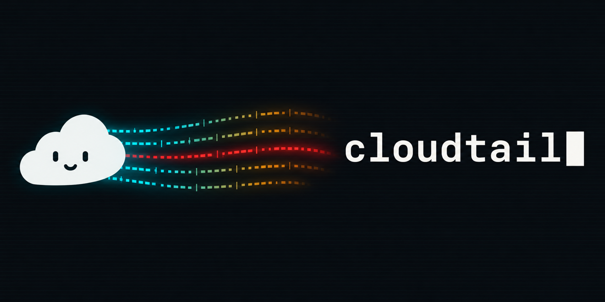

<p align="center">
  
</p>

<p align="center">
  <a href="LICENSE"></a>
  
</p>

# cloudtail

Your logs belong in your terminal.

The usual routine goes like this: open the AWS console, find the log group,
pick a stream, guess a time range, scroll, lose your place, refresh, start
over. cloudtail replaces all of it with one command. Pick your log groups and
they stream in live, next to your editor and your shell, where you already
work. History, search, and the exact moment something broke are one key away.

```sh
go install github.com/joshskidmore/cloudtail@latest
cloudtail
```

That's it. A fuzzy picker opens, you choose a log group (or `Tab` a few of
them), and the last five minutes are already on screen when the live tail
starts.

## What it does

**Follows everything at once.** Watch one log group or ten. Each line carries
a short colored tag, so the API, the worker, and the Lambda that calls them
read as one story.

**Finds the problem for you.** Errors glow red, warnings yellow, and the
status line counts errors per minute. `e` jumps to the next one.

**Travels in time.** Press `t`, type `14:05` or `-2h`, and you are there.
cloudtail loads only the window you asked for, marks the gap between it and
the live tail, and `[` `]` widen it when you need more context.

**Filters like fzf.** If your fingers know fzf, they already know this:

```
\order | payment !healthcheck !"cache hit"
```

That reads as: lines about orders or payments, minus the health checks and
the cache noise.

**Speaks Lambda.** cloudtail follows request IDs through every line of an
invocation, even plain `print()` output. Select a line and the status bar
shows that request's duration, memory, and cold start time. Press `r` to see
only that request.

**Opens up JSON.** Press `Enter` on any line for a detail view with indented
JSON and the full context: group, stream, timestamp, request.

**Stays out of your way.** Lines are compact by default: local time, no
stream names, no duplicate timestamps. `f` brings back the raw line. `y`
copies a line through OSC 52 (works over SSH and inside tmux) and `w` saves
what you see to a file.

## Usage

```sh
cloudtail                                  # pick log groups, then watch
cloudtail watch production                 # skip the picker
cloudtail watch /aws/lambda/orders /aws/lambda/users
cloudtail watch production --since 1h      # start with an hour of history
cloudtail watch production --prefix api --filter error
cloudtail watch production | grep timeout  # plain lines when piped
```

The classic commands are still here:

```sh
cloudtail groups                           # list log groups
cloudtail streams production               # list streams in a group
cloudtail get production --start -2h       # print a time range and exit
cloudtail get production --prefix api --start 2018-06-26 --stop 2018-06-28
```

## Keys

Press `?` inside cloudtail for this list.

| Key | Action |
|---|---|
| `↑` `↓` `j` `k`, click | select a line |
| `PgUp` `PgDn`, wheel | scroll |
| `g` / `G` | first line / newest line, and follow |
| `Enter` | detail view |
| `/`, `n` `N` | search, next / previous match |
| `\` | filter |
| `e` / `E` | next / previous error |
| `t` | go to a time: `15:30`, `15:30:10`, `-10m`, `2026-11-10 15:30` |
| `[` / `]` | load 15 minutes before / after |
| `r` | only this Lambda request (press again for all) |
| `o` | switch log groups |
| `y` | copy the selected line |
| `w` | save the shown lines to a file |
| `f` | full / compact lines |
| `Esc` | clear the search, then the filter, then the request |
| `q` | quit |

## Filter syntax

fzf's extended search syntax, with exact matching instead of fuzzy:

| Filter | Keeps lines that |
|---|---|
| `a b` | contain a and b |
| `!a` | do not contain a |
| `a \| b` | contain a or b (binds tighter than a space) |
| `"a b"` | contain the phrase "a b" |
| `^a` / `a$` | have a message that starts / ends with a |

Lowercase terms ignore case. Add an uppercase letter and the term matches
case exactly.

## AWS profile and region

cloudtail uses your default AWS profile and region. Override them per run or
per shell:

```sh
cloudtail --profile personal --region us-west-1

export AWS_PROFILE=work
export AWS_REGION=us-west-1
```

Credentials come from the standard AWS chain, including SSO profiles, assumed
roles (with an MFA prompt), and environment variables. `--endpoint-url`
points cloudtail at a custom endpoint such as LocalStack.

Times given to `--since`, `--start`, and `--stop` without a zone (for example
`2018-06-26` or `2018-06-26 12:00:00`) are local time. Use RFC3339 for an
explicit zone.

## Build from source

```sh
git clone git@github.com:joshskidmore/cloudtail.git
cd cloudtail
go build -o cloudtail .
go test ./...
```

Recent log groups live in `$XDG_STATE_HOME/cloudtail/recent`
(default `~/.local/state/cloudtail/recent`).

## Credits

cloudtail grew out of [saw](https://github.com/TylerBrock/saw) by Tyler Brock,
a sharp little CloudWatch tool that did the hard part first. The `groups`,
`streams`, and `get` commands and the event formatting come from saw. Both
projects are MIT licensed; see [LICENSE](LICENSE).
